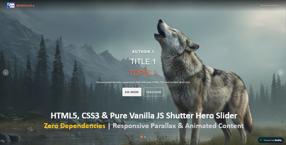

# Gla Shutter Hero Slider <span style="background-color: #f1683a; color: #fff; padding: 2px 8px; border-radius: 4px; font-size: 0.9rem; font-weight: 600; vertical-align: middle;">v2.2.0</span>



> An ultra-fast, lightweight (<8kB), and modern fullscreen hero slider component with a cinematic shutter reveal transition and parallax depth effect. Built with **100% pure Vanilla JavaScript and native CSS**.

[](#)
[](LICENSE)
[](#)
[](#)

---

## 🚀 Live Demo

Check out the interactive live demo deployed on Netlify:  
👉 **[View Live Demo](https://gla-shutter-hero-slider.netlify.app)**

---

## ✨ Key Features

- **100% Dependency-Free:** Zero jQuery, Zero Swiper.js, Zero external libraries required.
- **Blazing Fast (<8kB total weight):** Minimal execution footprint, DOM loaded in sub-150ms.
- **Cinematic Shutter Reveal Effect:** Smooth `clip-path` CSS transitions between slide switches.
- **Scroll-Driven Parallax Depth:** Adds immersive visual depth as the user scrolls.
- **Modular Content Visibility:** Toggle individual slide elements (author, title, topic, description, buttons) on/off per slide via JSON settings without altering HTML.
- **Dynamic 9-Grid Content Placement:** Freely position slide content anywhere on screen (`top-left`, `center-right`, `bottom-center`, etc.) with precise vertical and horizontal alignment overrides.
- **Multi-Platform Gesture Support:** Global touch-swipe (mobile/tablet) and desktop mouse drag-to-swipe interaction for intuitive navigation.
- **Text Selection Protection:** Native CSS `user-select` rules prevent accidental text highlighting during drag or click gestures.
- **Configurable Pause-on-Hover:** Control autoplay pausing directly via HTML data attribute (`data-stop-on-hover="true|false"`).
- **JSON-Driven Architecture:** Effortlessly update titles, topics, colors, links, borders, and buttons via `slides.json`.
- **Clean & Unminified Codebase:** Fully documented, unminified source files kept clean for easy commercial distribution, theme integration, and maintenance.

---

## 📁 Project Structure

```text
gla-shutter-hero-slider/
├── README.md               # GitHub Landing Page
├── LICENSE                 # MIT License File
├── .gitignore              # Git Ignore Rules
├── preview.jpg             # Repository Banner Image
├── README.txt              # Commercial Product Overview & Changelog
├── Documentation/
│   └── index.html          # Comprehensive HTML Setup & Integration Guide
└── Main-Files/
    ├── index.html          # Interactive Showcase Landing Page
    └── assets/
        ├── css/
        │   ├── style.css       # Full Unminified CSS Source (v2.2.0)
        │   └── style.min.css   # Minified CSS Production File
        ├── js/
        │   ├── script.js       # Full Unminified JS Engine (v2.2.0)
        │   └── script.min.js   # Minified JS Production File
        ├── json/
        │   └── slides.json     # Central Configuration File
        └── images/
            ├── logo.png
            ├── img1.jpg
            └── img2.jpg
```

---

## 🛠️ Quick Start Guide

### 1. Embed Files

Include the CSS in your `<head>` and JS before the closing `</body>` tag (you can use the minified versions for production):

```html
<!-- Stylesheet -->
<link rel="stylesheet" href="assets/css/style.min.css" />

<!-- Script -->
<script src="assets/js/script.min.js" defer></script>
```

### 2. Markup Setup

Add the slider container with custom data attributes to your page:

```html
<div
	class="wp-block-gla-heroslider"
	data-autoplay="true"
	data-interval="7000"
	data-stop-on-hover="true"
	data-hide-progress="false"
	data-hide-navigation="false"
	data-hide-pagination="false"
>
	<div class="slide-list"></div>
	<div class="slide-arrows">
		<button id="prev">&lt;</button>
		<button id="next">&gt;</button>
	</div>
	<div class="slide-pagination"></div>
	<div class="slide-time"></div>
</div>
```

### 3. Configure Slides (`assets/json/slides.json`)

Manage content, visibility, positioning, and button styles easily without altering JavaScript logic:

```json
{
	"settings": {
		"version": "2.1.0"
	},
	"slides": {
		"slide1": {
			"showContent": {
				"author": true,
				"title": true,
				"topic": true,
				"description": true,
				"button1": true,
				"button2": true
			},
			"author": "AUTHOR 1",
			"title": "TITLE 1",
			"topic": "TOPIC 1",
			"description": "Discover premium web components built with pure HTML, CSS, and modern JavaScript.",
			"imageUrl": "assets/images/img1.jpg",
			"alignment": "bottom-right",
			"authorColor": "#ffffff",
			"authorFontSize": 24,
			"authorFontFamily": "Open sans, sans-serif",
			"titleColor": "#ffffff",
			"titleFontSize": 48,
			"titleFontFamily": "Open sans, sans-serif",
			"topicColor": "#f1683a",
			"topicFontSize": 48,
			"topicFontFamily": "Open sans, sans-serif",
			"button1Text": "SEE MORE",
			"button1Url": "#",
			"button1Color": "#eee",
			"button1TextColor": "#000",
			"button1HoverColor": "#f1683a",
			"button1HoverTextColor": "#fff",
			"button1BorderRadius": 4,
			"button1Outline": true,
			"button1OutlineColor": "#fff",
			"button1OutlineWidth": 1,
			"button2Text": "SUBSCRIBE",
			"button2Url": "#",
			"button2Color": "transparent",
			"button2TextColor": "#fff",
			"button2HoverColor": "#f1683a",
			"button2HoverTextColor": "#fff",
			"button2BorderRadius": 4,
			"button2Outline": true,
			"button2OutlineColor": "#fff",
			"button2OutlineWidth": 1
		}
	}
}
```

---

## ⚙️ Data Attributes

| Attribute              | Type    | Default | Description                                                                                      |
| :--------------------- | :------ | :------ | :----------------------------------------------------------------------------------------------- |
| `data-autoplay`        | Boolean | `true`  | Enables or disables automatic slide transitions.                                                 |
| `data-interval`        | Number  | `7000`  | Sets slide transition interval in milliseconds.                                                  |
| `data-stop-on-hover`   | Boolean | `true`  | Pauses autoplay when hovering over the slider. Set to `false` to keep autoplay running on hover. |
| `data-hide-progress`   | Boolean | `false` | Hides or shows the top progress bar.                                                             |
| `data-hide-navigation` | Boolean | `false` | Hides or shows the navigation arrows (`prev`/`next`).                                            |
| `data-hide-pagination` | Boolean | `false` | Hides or shows the pagination dots.                                                              |

---

## 🔄 Changelog

### v2.2.0 (2026-11-10)

- **Engine & DOM Integrity:** Fixed a critical bug where slide jumps via pagination (especially across slides > 2 or larger distances) could desynchronize the internal DOM queue and the carousel's Z-index hierarchy.
- **Pagination Optimization:** Non-adjacent pagination buttons are now intelligently managed and restricted during active animations to completely prevent visual glitches (such as overlapping shutter transitions on distant jumps) and subsequent navigation desyncs.
- **Enhanced Stability:** Ensures permanent, robust synchronization between `globalCurrentIndex`, the `.slide-list` child nodes, and all navigation controls (arrows, swipe gestures, and pagination).

### v2.1.0 (2026-11-09)

- Minor bugfixes & improvements.
- Missing FontFamily added to author, title & topic.
- Added configurable HTML attribute control for hiding progress bar on top (`data-hide-progress`).
- Added configurable HTML attribute control for hiding nav-buttons (`data-hide-navigation`).
- Added configurable HTML attribute control for hiding pagination (`data-hide-pagination`).
- Updated comprehensive HTML documentation to cover all v2.1.0 enhancements.

### v2.0.0 (2026-11-08)

- Added dynamic 9-grid vertical and horizontal content positioning via JSON alignment.
- Added strict vertical CSS positioning overrides (`top`, `bottom`, `center`) in `style.css`.
- Added global touch-swipe (mobile/tablet) and desktop mouse drag-to-swipe interaction.
- Added configurable HTML attribute control for hover pause (`data-stop-on-hover`).
- Added user-select protection in CSS to prevent unwanted text selection during drag gestures.
- Enhanced responsive mobile background image scaling.
- Updated comprehensive HTML documentation to cover all v2.0.0 enhancements.

### v1.0.0 (2026-11-07)

- Initial commercial release.
- Standalone HTML/CSS/JS engine with dynamic JSON loading.
- Added full parallax effect support and responsive shutter clip-path transitions.

---

## 📄 Documentation

For full custom styling, dynamic API reference, alignment system details, and step-by-step installation options, open `Documentation/index.html` in your browser.

---

## 📜 License

This project is open-source and available under the [MIT License](LICENSE).

---

\*Created with ❤️ by **WebDevGLa\***
